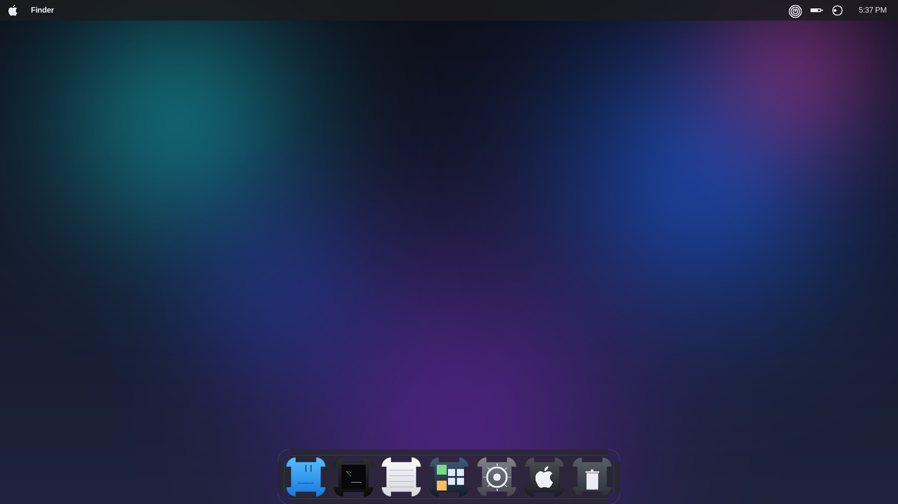
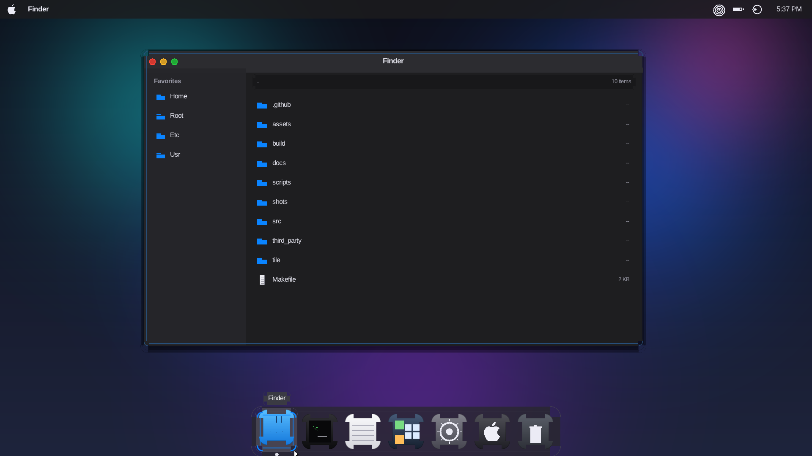
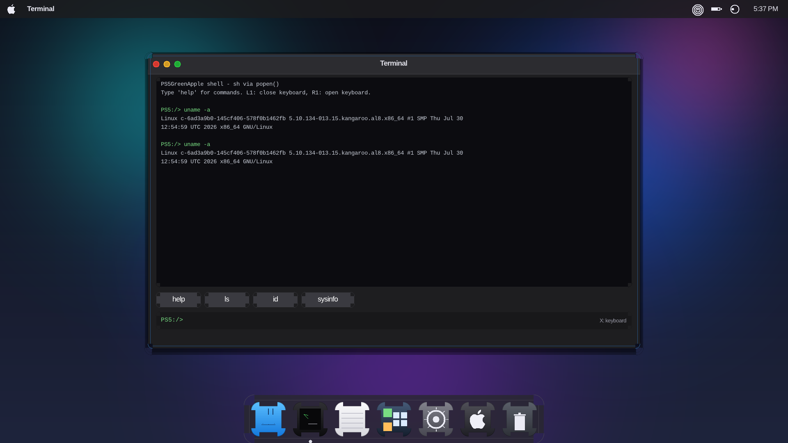
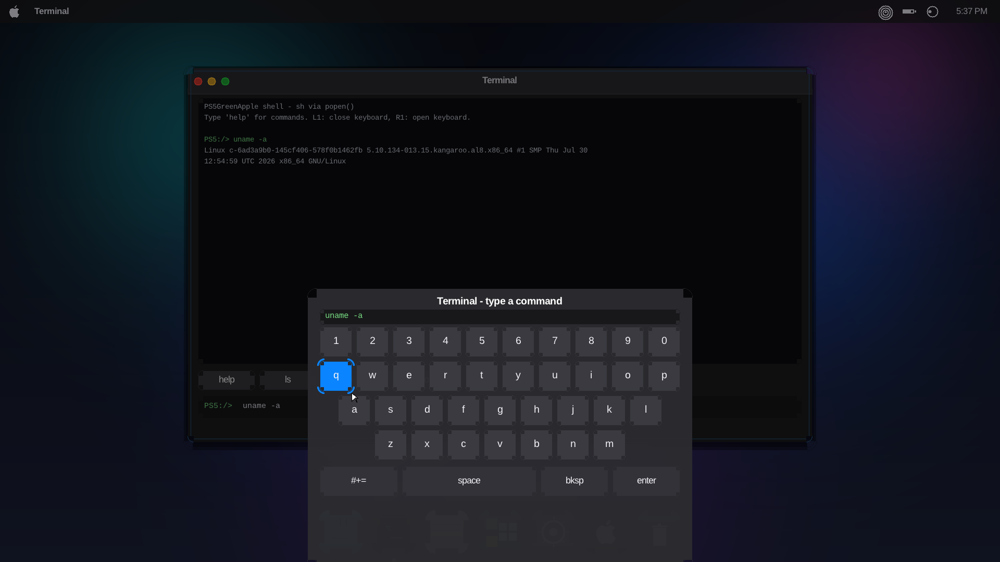
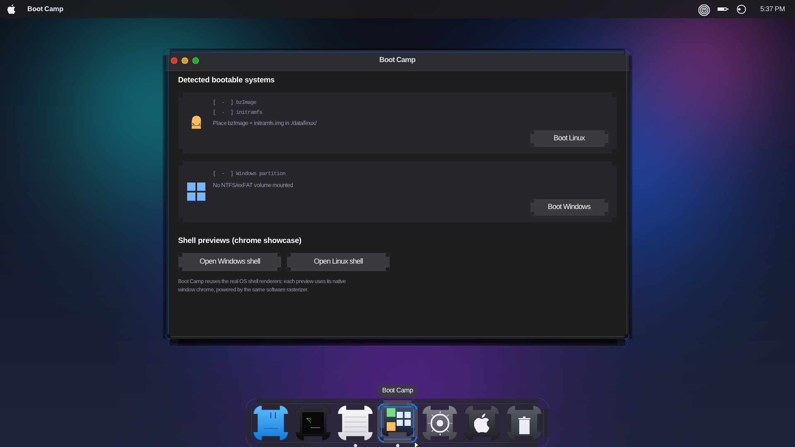
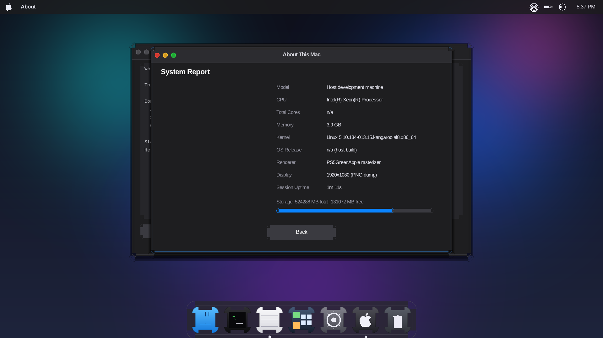

<div align="center">

# PS5GreenApple

**A macOS Sonoma–style desktop environment for jailbroken PlayStation 5 consoles**

Native SDL2 homebrew · pure-software renderer · FW 3.00 – 13.60 · built with [ps5-payload-sdk](https://github.com/ps5-payload-dev/sdk)



[](https://github.com/YOUR_GH_USERNAME/PS5GreenApple/actions/workflows/ci.yml)


</div>

## What is this?

PS5GreenApple turns your jailbroken PS5 into a (fake) Mac. It is a native
payload `.elf` — not a web exploit page — that draws a complete macOS Sonoma–
inspired desktop on top of a game console: boot chime animation included
(minus the chime), translucent menu bar, glass dock, real apps, and a
Boot Camp app that pokes fun at the fact that you are *not* on a Mac.

Everything is rendered by a hand-written software rasterizer into a single
1920×1080 ARGB8888 framebuffer — no GPU, no shaders, no PSSL. Text is drawn
with stb_truetype over Liberation fonts embedded directly in the binary, so
the payload has zero external asset dependencies.

## Features

| Area | Details |
|------|---------|
| **Boot** | Fading Apple-logo boot animation with progress bar (`X` skips) |
| **Desktop** | Sonoma dark theme, 3 procedural aurora wallpapers, translucent menu bar with live clock, glass dock with running-app indicators and tooltips |
| **Navigation** | D-pad focus cursor with animated selection ring (PS5-style), full DualSense mapping, on-screen keyboard |
| **Finder** | Real filesystem browser — browse `/data`, `/mnt/usb0`, `/`, open folders, launch `.txt` files in TextEdit |
| **Terminal** | Real shell via `popen()` — run `ls`, `id`, `uname -a`, anything; quick-command buttons; command input via OSK |
| **TextEdit** | OSK-driven text editor, saves to `/data/PS5GreenApple/notes.txt` |
| **About** | "About This Mac" page + full System Report (CPU, kernel, firmware, loader, storage) read from live `sysctl` |
| **Settings** | Wallpaper, accent color, clock format, FPS overlay — persisted to `/data/PS5GreenApple/settings.ini` |
| **Boot Camp** | Detects Linux `bzImage`/initramfs payloads and NTFS/exFAT Windows volumes; opens preview shells with **Windows** and **Linux** window chrome |

### DualSense controls

| Button | Action |
|--------|--------|
| D-pad / left stick | Move focus between hotspots |
| ✕ Cross | Activate selected item |
| ○ Circle | Back / close window |
| □ Square | Save in TextEdit |
| R1 / L1 (or R2 / L2) | Scroll focused window |
| OPTIONS | Power dialog (restart) |
| PS button | (Reserved) |

## Screenshots

| Boot | Finder | Terminal |
|------|--------|----------|
|  |  |  |

| On-screen keyboard | Boot Camp | System Report |
|--------------------|-----------|---------------|
|  |  |  |

All screenshots are real output: `make shots` runs the app headless and
captures them from the actual framebuffer (see `scripts/demo-script.txt`).

## Building

### 1. Toolchain

Install [ps5-payload-sdk](https://github.com/ps5-payload-dev/sdk) and export it:

```bash
git clone https://github.com/ps5-payload-dev/sdk
export PS5_PAYLOAD_SDK=$(pwd)/sdk
export PATH=$PATH:$PS5_PAYLOAD_SDK/bin
```

### 2. SDL2 for PS5

The UI uses SDL2 for video + DualSense input. Build the PS5 SDL port once
and install it into the SDK:

```bash
git clone --recursive https://github.com/ps5-payload-dev/SDL
cd SDL && mkdir build && cd build
../configure --host=x86_64-pc-freebsd12-elf \
    --prefix=$PS5_PAYLOAD_SDK/target \
    --disable-shared --enable-static
make -j$(nproc) && make install
```

### 3. Build the payload

```bash
make            # -> ps5greenapple.elf
make deploy     # same, then sends it to $PS5_HOST:$PS5_PORT (9021)
```

### Host-side testing (no PS5 needed)

The exact same UI code runs headless on any Linux/macOS box and writes PNG
screenshots driven by a script — that is how the images in this README were
produced:

```bash
make host       # -> build/host/ps5greenapple-dump
make shots      # renders scripts/demo-script.txt into shots/*.png
```

CI (`.github/workflows/ci.yml`) builds both the host screenshots and the
PS5 ELF on every push; the ELF is attached as a workflow artifact.

## Installing on the PS5

Full walkthrough in **[docs/INSTALL.md](docs/INSTALL.md)**. Short version —
pick the loader you already use:

### etaHEN + elfldr (recommended)
1. Jailbreak with your exploit chain for your firmware (e.g. **Relapse / UMTX**
   for 13.60+, BD-J or WebKit for lower FW) and run **etaHEN**.
2. Start the **ELF loader** from etaHEN's toolbox (or run
   [ps5-payload-dev/elfldr](https://github.com/ps5-payload-dev/elfldr)).
3. From your PC:
   ```bash
   nc -q0 <PS5-IP> 9021 < ps5greenapple.elf
   ```

### ps5-payload-websrv (browser launch)
1. Send [websrv](https://github.com/ps5-payload-dev/websrv) to port `9021`.
2. Copy the release folder to your PS5 or USB stick:
   ```
   /data/homebrew/PS5GreenApple/eboot.elf        <- ps5greenapple.elf
   /data/homebrew/PS5GreenApple/sce_sys/icon0.png
   ```
   (`/mnt/usb0/homebrew/...` works too)
3. Open `http://<PS5-IP>:8080/` on any device and click the icon.

### WebKit Autoloader tile
See [`tile/`](tile/) — drop the folder on a USB stick under `PS5/WWW/tile/`
to launch straight from the WebKit Autoloader without a PC on the network.

## Project layout

```
├── src/                 # all C sources (single-window apps, software renderer)
│   ├── gfx.c            # ARGB8888 software rasterizer (clipping, AA, gradients)
│   ├── font.c fonts.S   # stb_truetype + .incbin'd Liberation fonts
│   ├── desktop.c wm.c   # shell: wallpaper, menubar, dock, dialogs, windows
│   ├── app_*.c          # Finder / Terminal / TextEdit / About / Settings / Boot Camp
│   ├── backend_sdl2.c   # PS5 + desktop SDL2 backend (DualSense, video out)
│   └── backend_dump.c   # headless scripted-screenshot backend
├── assets/fonts/        # Liberation Sans/Mono (SIL OFL 1.1)
├── scripts/             # screenshot driver script
├── tile/                # WebKit Autoloader tile
├── docs/                # INSTALL.md, ARCHITECTURE.md
└── .github/workflows/   # CI: host screenshots + PS5 ELF artifact
```

## Firmware support

The payload targets the ps5-payload-sdk ELF loader, which is available on
every jailbreakable firmware (3.00 – 13.60 at time of writing) through
etaHEN's built-in ELF loader or ps5-payload-dev/elfldr. The app itself does
not care which exploit landed the loader — if `nc` to port 9021 works, so
does PS5GreenApple.

> **Disclaimer**: this is a homebrew toy desktop, not an actual macOS port
> and not affiliated with Apple or Sony. Use at your own risk on your own
> console.

## License

MIT — see [LICENSE](LICENSE). Embedded components: Liberation fonts
(SIL OFL 1.1), stb_truetype/stb_image_write (public domain / MIT).
